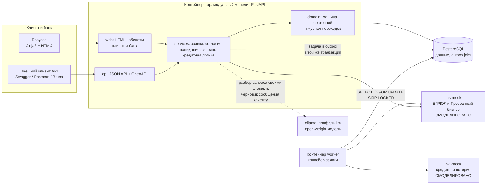
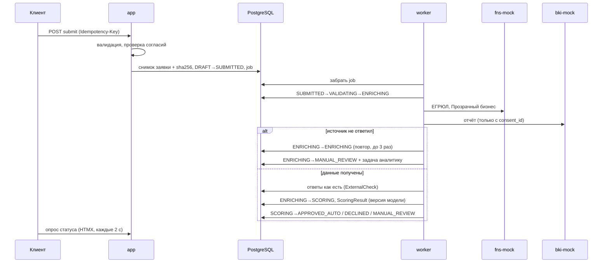
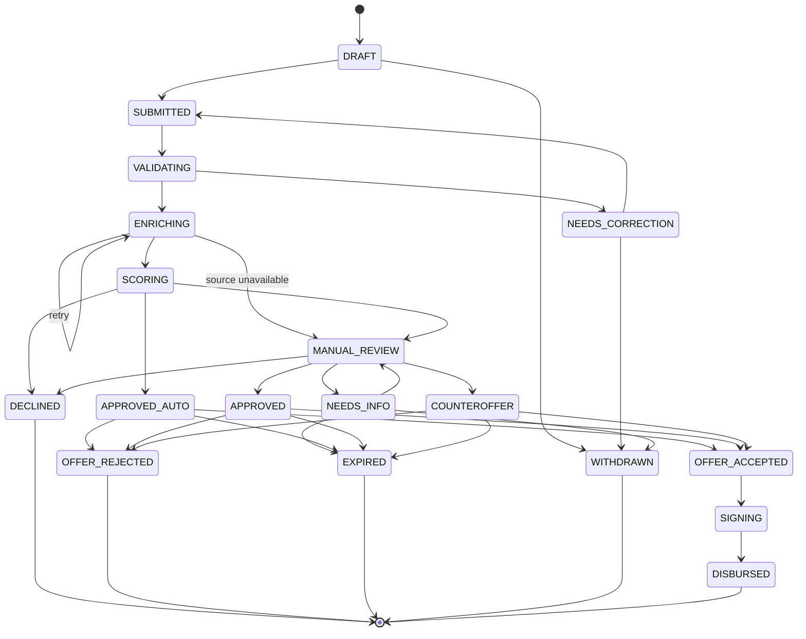
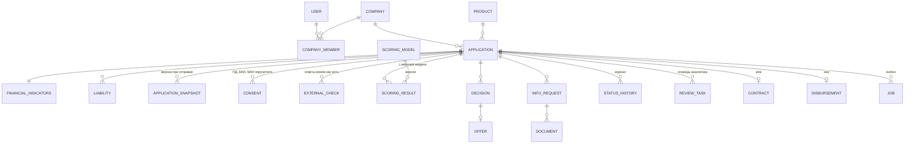

# Архитектура

## Компоненты

**Почему модульный монолит.** На хакатоне микросервисы добавляют риск без ценности для проверки. Границы модулей (`web`, `api`, `services`, `domain`) и отдельный воркер позволяют позже вынести конвейер и интеграции в отдельные сервисы.

**LLM — только помощник.** Модель разбирает запрос клиента своими словами (`services/intake.py`) и предлагает аналитику черновик сообщения клиенту (`services/client_message.py`). Ответ — строго по JSON-схеме; числа из ответа принимаются, только если они есть в тексте клиента; черновик с внутренней кухней (БКИ, скоринг, пороги), новыми числами или обещаниями отбрасывается. Любой сбой — правила или шаблон, после сбоя модель полминуты не вызывается. Кредитных решений модель не принимает.

**Моки ФНС и БКИ и тестовые данные.** Моки — отдельные контейнеры с тем же контрактом, что был бы у настоящих источников. Исходные данные — в `mocks/data.py`; правки для демо моки принимают через служебный API (`/admin/reports/{inn}`, `/admin/companies/{inn}`) и хранят в `bki.json` и `fns.json` на томе `mockdata`, накладывая поверх исходных. Вызывает этот API только страница «Тестовые данные» администратора банка (`web/sandbox.py`, `services/sandbox.py`); там же предпросмотр того, как скоринг прочитает историю. Правка действует на будущие запросы: ответы, полученные при рассмотрении заявок, хранятся в `external_checks` как есть.

**Почему outbox, а не брокер.** Задача на обработку пишется в таблицу `jobs` в той же транзакции, что и переход `DRAFT → SUBMITTED`. Если транзакция откатилась, задачи нет; если задача есть, заявка точно отправлена. Воркер забирает задачи через `SKIP LOCKED`, поэтому воркеров можно запустить несколько. Брокер (RabbitMQ, Kafka) можно добавить позже, читая тот же outbox.

## Конвейер заявки

## Машина состояний

Источник правды — `app/domain/states.py`. Недопустимый переход отклоняется сервисом `app/domain/transitions.py`, а не интерфейсом. Каждый переход пишется в `status_history`: кто, когда, из какого статуса, основание.

Права на переходы: клиент отправляет, отзывает, отвечает на запрос и принимает или отклоняет предложение; аналитик принимает решения в `MANUAL_REVIEW`; система ведёт конвейер, истечение сроков, подписание и выдачу (моки).

## Модель данных

Ключевые решения:

- `applications.version` — оптимистичная блокировка (`version_id_col` SQLAlchemy). Два аналитика с одной версией: первый сохраняет, второй получает `409 version_conflict` (сценарий T9).
- `application_snapshots` — неизменяемый JSON заявки на момент отправки и его sha256. Повторная отправка после исправлений создаёт новую версию.
- `external_checks` и `scoring_results` хранят входы и ответы как есть: решение можно воспроизвести.
- `idempotency_keys` — повторная отправка с тем же `Idempotency-Key` возвращает тот же ответ, а не дубль.
- Суммы в целых рублях (`BIGINT`), ставки `NUMERIC(5,2)`, время в UTC с часовым поясом, отображение в Europe/Moscow.

## Скоринг и решение

Три слоя, как в кейсе:

1. **Жёсткие стопы** (`services/scoring.py::check_knockouts`): ликвидация или реорганизация, срок бизнеса меньше минимума продукта, действующая просрочка в БКИ. Отсутствие согласия и лимиты продукта ловит валидация до отправки.
2. **Балльная карта** v1.0 (`services/scoring.py`, баллы — `services/scorecard.json`): факторы — срок бизнеса, платёжная дисциплина, поручительство, динамика выручки, запрос к выручке, долговая нагрузка `(долг + запрос) / (EBIT + амортизация)`, налоговая недоимка.
   - **Шкала шансов:** 60 баллов ↔ вероятность дефолта за год (PD) 5%, каждые 10 баллов — шансы дефолта вдвое ниже; у любой оценки есть PD (`pd_of`).
   - **Калибровка** (`tools/calibrate.py`, отчёт — [`calibration.md`](calibration.md)): база и баллы — логистическая регрессия по корзинам факторов на синтетическом портфеле из 200 тыс. заявок, где дефолт возникает из денежного потока и качества управления, а не из баллов. Монотонность соблюдается (соседние корзины-нарушители объединяются). На истории банка — тот же скрипт с `--data history.csv`.
   - **Пороги — из риск-аппетита:** отказ < 46 (ожидаемые потери PD × LGD без залога больше 5 п. п. — максимальной надбавки к ставке), автоодобрение ≥ 68 (PD ≤ 3%), между — аналитик.
   - **Платёжная дисциплина** по сроку и размеру просрочки: до 5 дней — техническая, 6–30 — небольшая, 31–90 — серьёзная, больше 90 — дефолт (590-П, п. 3.7); просрочка до 50 тыс. ₽ или до 1% долга не учитывается (порог существенности, как у EBA); свежие и частые хуже давних.
   - **Залога в баллах нет:** он не снижает вероятность дефолта, а уменьшает потери — поэтому работает в кредитной логике.
   Параметры лежат в таблице `scoring_models` с версией; новая версия из кода при старте становится активной, прежние остаются в истории.
3. **Кредитная логика продукта** (`services/credit_logic.py`): авто-лимит, лимит без залога, допустимая нагрузка, недоимка → ручной разбор с подсказкой суммы.
   - **Ставка** = базовая ставка продукта + ожидаемые потери PD × LGD (в п. п., вверх до 0,1).
   - **LGD** по Базелю III (CRE32): без залога 40%; часть, покрытая залогом с дисконтом, — недвижимость 20%, транспорт, оборудование и товары 25%, депозит 0%. Дисконт к стоимости: недвижимость и транспорт 40% (как в Базеле), оборудование 50%, товары 60%, депозит 0%.
   - **Лимит без залога** (у кредитной линии 10 млн): сверх него — в пределах стоимости залога с дисконтом.
   - **История платежей — политика поверх баллов:** просрочка больше 30 дней за последний год или больше 90 дней за 2 года — без автоодобрения, даже при высокой оценке; решает аналитик.

   Здесь же две проверки, которые зависят от продукта и срока:
   - **Покрытие платежей (DSCR)** = (EBIT + амортизация) / платежи по всем кредитам за год, норма ≥ 1,25. Долговая нагрузка в карте — про размер долга и срока не видит: 3 млн на 6 и на 36 месяцев для неё одинаковы, а платёж различается в пять раз. Платёж по новому кредиту — аннуитет по ставке продукта; по текущим — из БКИ или анкеты (берём больший), а если неизвестен — оценка по остатку за 2 года под 20%. Для овердрафта и кредитной линии считаем так же, как если бы долг гасился равными платежами, — это консервативно. Покрытие ниже нормы → ручной разбор, а подсказка аналитику называет и сумму на этот срок, и срок, на котором проходит вся сумма.
   - **Сверка анкеты с ФНС:** выручка в анкете выше выручки за прошлый год по «Прозрачному бизнесу» больше чем на 30% → авто-одобрения нет, сверяет аналитик (ОСВ 62, выписка). Прибыль сверяем по рентабельности: (EBIT + амортизация) / выручка в анкете против (выручка − расходы) / выручка по ФНС; разница больше 5 п. п. или убыток в ФНС при прибыли в анкете → аналитик. Сравниваем доли, а не рубли — выручка могла вырасти; запас 5 п. п. — потому что у ФНС прибыль уже после процентов и без амортизации. Компаниям младше года не применяем: полного года в ФНС ещё нет.

   Параметры (`min_dscr`, `revenue_gap`, допущения по текущим долгам) лежат в той же версии карты; ключей, которых нет в старой версии, берём по умолчанию. Покрытие и платежи сохраняются вместе с результатом скоринга и видны в карточке аналитика.

Баллы откалиброваны на синтетическом портфеле, а не на истории банка: веса согласованы между собой и с риск-аппетитом, карта различает риск (Gini 0,74 на отложенной выборке), но реальные PD появятся только после калибровки на портфеле банка. Подробно, с допущениями и источниками, — в [`calibration.md`](calibration.md).

Источники методики:

1. **Положение Банка России № 590-П**, п. 3.7 — сроки просрочки: до 5 дней — хорошее обслуживание долга, 6–30 — среднее, больше 30 — неудовлетворительное ([Гарант](https://base.garant.ru/71721612/5ac206a89ea76855804609cd950fcaf7/)).
2. **Базель III, CRE32** — потери при дефолте без залога 40% (CRE32.6), покрытой залогом части 20–25% и дисконт к стоимости залога 40% (CRE32.11) ([BIS](https://www.bis.org/committees/bcbs/basel-framework/81366/chapter.pdf)).
3. **EBA RTS 2016/06** — порог существенности просрочки: 500 евро и 1% долга; дефолт — после 90 дней ([EBA](https://www.eba.europa.eu/documents/10180/1597002/Final+draft+RTS+on+the+materiality+threshold+for+credit+obligations+%28EBA-RTS-2016-06%29.pdf/fe1db887-c6dc-4777-89c1-4f243584cafd)).
4. **Эксперт РА**, «Рынок кредитования МСБ по итогам 2025 года», 30.04.2026 — доля просрочки в портфеле МСБ снизилась с 4,4 до 4% ([raexpert.ru](https://raexpert.ru/researches/banks/msb_2025)).
5. **Исследование Точка Банка** (пересказ Mail.ru Финансов, 26.05.2026) — из компаний и ИП, зарегистрированных в 2022 году, к концу 2025-го работает половина ([Mail.ru Финансы](https://finance.mail.ru/article/v-rossii-iz-otkryityih-tri-goda-nazad-kompanij-zakryilas-kazhdaya-vtoraya-69210367/)).

## Проверка шансов до подачи

`app/services/precheck.py` прогоняет ту же скоринговую карту и кредитную логику по всем продуктам, но без запроса в БКИ (согласия ещё нет): о просрочках за 2 года спрашиваем клиента и переводим ответ в формат отчёта БКИ с границами из активной версии модели. Тяжесть просрочек клиент выбирает сам: «до 30 дней», «больше 30 дней» или «есть сейчас». Залог — вид и стоимость, как в заявке. Финансы — со слов клиента или оценка по «Прозрачному бизнесу», платёж по текущим кредитам — со слов клиента или из прошлой заявки (не знает — оценим по остатку). В БД ничего не пишется. Строка «Ежемесячные платежи» показывает новый платёж и долю прибыли, которая уйдёт на все кредиты, а подсказки — комфортную сумму и срок, на котором проходит вся сумма. Клиент получает уровень шансов, факторы (хорошо / заметно / плохо / нет данных), вердикт по каждому продукту и комфортную сумму — без баллов и порогов.

## Безопасность

- Регистрация — только для клиентов (роль CLIENT); сотрудников банка заводит банк. Пароль: не короче 8 символов, буквы и цифры, не из списка простых; обязательное согласие на обработку ПД пишется в журнал. Подтверждения почты нет — по условию кейса сценарий не уходит в почту и SMS.
- Пароли: PBKDF2-SHA256, 240 000 итераций, соль на пользователя. Для несуществующего email пароль тоже «проверяется» — по времени ответа не понять, зарегистрирован ли адрес.
- Подбор пароля: не больше 5 неудачных входов на пару email + IP и 30 с одного IP за 10 минут (429 и `Retry-After`), не больше 10 регистраций с IP в час. Неудачные входы — в журнал аудита.
- Сессия в подписанной cookie (HttpOnly, SameSite=Lax, `SECURE_COOKIES=true` за HTTPS), новая сессия при входе и смене пароля. Секрет подписи — `SECRET_KEY` из окружения; если не задан или совпадает с публичным примером, генерируется случайный: иначе любой подписал бы cookie сам и вошёл под любым пользователем.
- CSRF: токен для всех HTML-форм; JSON API принимает только `application/json`, а cookie `SameSite=Lax` не уходит с чужих сайтов.
- Заголовки: строгий CSP (`script-src 'self'` — никаких inline-скриптов, `frame-ancestors 'none'`), `X-Frame-Options: DENY`, `X-Content-Type-Options: nosniff`, `Referrer-Policy`. Swagger (`/api/docs`) — без CSP, он грузит скрипты с CDN.
- RBAC на уровне сервиса: клиент видит только заявки компаний, где он участник; чужая заявка — 404 (не раскрываем существование, T10). API банка — только `ANALYST`/`ADMIN`.
- Участие в компании: подключить компанию по ИНН может только первый пользователь (он получает право подписи, проверка полномочий смоделирована); дальше коллег добавляет участник с правом подписи. Подписать договор может только участник с `can_sign` — бухгалтер готовит и принимает предложение, директор подписывает.
- Переход после входа (`next`) — только относительный путь внутри сайта, без `//`, `\` и управляющих символов: браузер выбрасывает из адреса табуляцию и переводы строк, и `/<TAB>/evil.com` превратился бы в `//evil.com`.
- htmx настроен строго (`htmx-config`): без `eval` и вставки скриптов, запросы только к своему сайту, без кеша истории в `localStorage` (там оказались бы финансы со страниц).
- Автотест обходит все маршруты приложения: без входа открыты только вход, регистрация, проверка здоровья, документация API и публичный каталог продуктов.
- Администрирование — только роль `ADMIN`: каталог продуктов (с проверкой полей и версиями), включение версии карты (с пробным расчётом), тестовые данные моков. Всё пишется в журнал и видно на странице «Продукты и скоринг».
- Загрузка файлов: белый список расширений, лимит размера (запрос больше лимита отсекается до разбора — 413, файл читается не дальше лимита), нормализация имени, sha256, отдача только как вложение.
- Финансы из «Проверки шансов» передаются в теле POST, а не в URL — не оседают в логах веб-сервера.
- Ввод: где есть готовый список — только он (должность в команде, документ для запроса, цель, срок); числа ограничены разумными пределами (сумма до 10¹⁵ ₽, сотрудников до миллиона, срок ответа клиенту 1–30 дней, ставка — конечное число от 0 до 100), строки — длиной полей. Раньше число с двадцатью цифрами или срок погашения в 40 символов роняли запрос с 500 на PostgreSQL. ФИО при регистрации — буквами, фамилия и имя.
- Секреты только через переменные окружения; контейнеры работают не от root; наружу открыт только сайт.
- Не сделано в MVP: подтверждение почты или телефона и восстановление пароля (условие кейса), шифрование чувствительных полей в БД, общий счётчик попыток для нескольких копий приложения, ротация ключей. Это в «потенциале развития».
