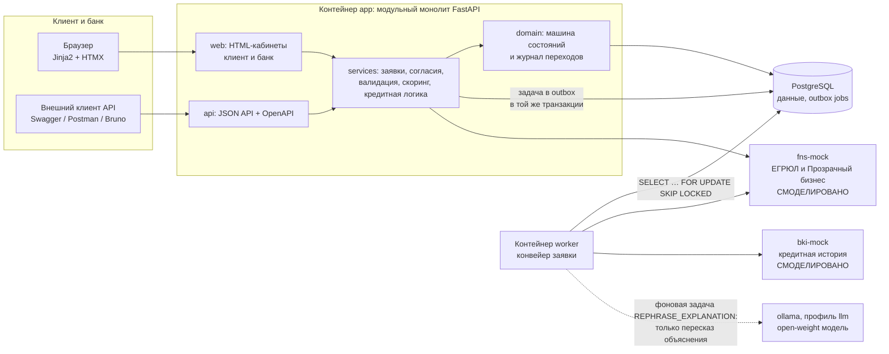
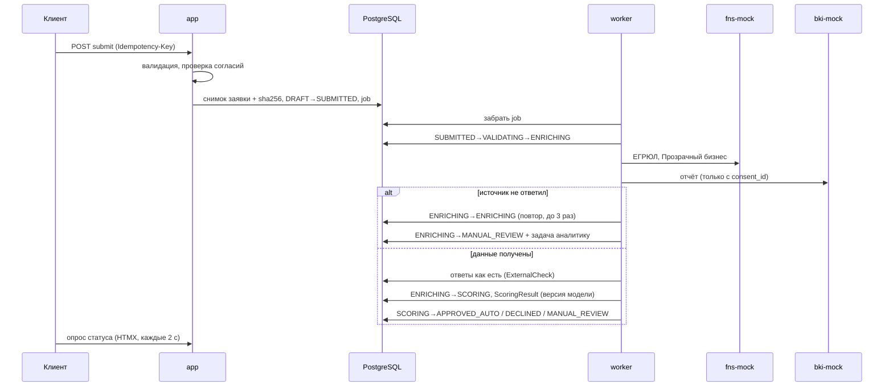
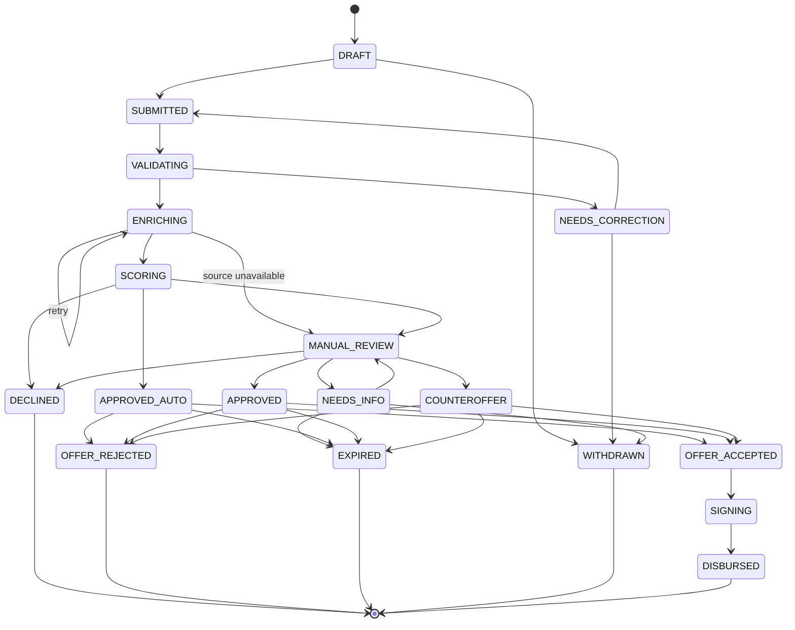
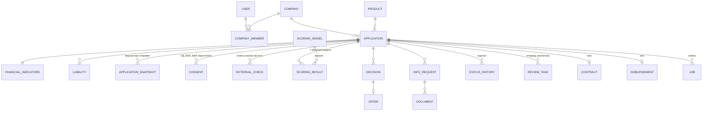

# Архитектура

## Компоненты

**Почему модульный монолит.** На хакатоне микросервисы добавляют риск без ценности для проверки. Границы модулей (`web`, `api`, `services`, `domain`) и отдельный воркер позволяют позже вынести конвейер и интеграции в отдельные сервисы.

**LLM — тоже через outbox.** Решение и детерминированный текст причин сохраняются сразу. Если задан `LLM_URL`, в `jobs` ставится задача `REPHRASE_EXPLANATION`: воркер просит модель пересказать текст, проверяет ответ (новые числа, обещания, язык, длина) и только тогда заменяет шаблон. Медленная или упавшая модель не задерживает ни конвейер, ни аналитика.

**Почему outbox, а не брокер.** Задача на обработку пишется в таблицу `jobs` в той же транзакции, что и переход `DRAFT → SUBMITTED`. Если транзакция откатилась, задачи нет; если задача есть, заявка точно отправлена. Воркер забирает задачи через `SKIP LOCKED`, поэтому воркеров можно запустить несколько. Брокер (RabbitMQ, Kafka) можно добавить позже, читая тот же outbox.

## Конвейер заявки

## Машина состояний

Источник правды — `app/domain/states.py`. Недопустимый переход отклоняется сервисом `app/domain/transitions.py`, а не интерфейсом. Каждый переход пишется в `status_history`: кто, когда, из какого статуса, основание.

Права на переходы: клиент отправляет, отзывает, отвечает на запрос и принимает или отклоняет предложение; аналитик принимает решения в `MANUAL_REVIEW`; система ведёт конвейер, истечение сроков, подписание и выдачу (моки).

## Модель данных

Ключевые решения:

- `applications.version` — оптимистичная блокировка (`version_id_col` SQLAlchemy). Два аналитика с одной версией: первый сохраняет, второй получает `409 version_conflict` (сценарий T9).
- `application_snapshots` — неизменяемый JSON заявки на момент отправки и его sha256. Повторная отправка после исправлений создаёт новую версию.
- `external_checks` и `scoring_results` хранят входы и ответы как есть: решение можно воспроизвести.
- `idempotency_keys` — повторная отправка с тем же `Idempotency-Key` возвращает тот же ответ, а не дубль.
- Суммы в целых рублях (`BIGINT`), ставки `NUMERIC(5,2)`, время в UTC с часовым поясом, отображение в Europe/Moscow.

## Скоринг и решение

Три слоя, как в кейсе:

1. **Жёсткие стопы** (`services/scoring.py::check_knockouts`): ликвидация или реорганизация, срок бизнеса меньше минимума продукта, действующая просрочка в БКИ. Отсутствие согласия и лимиты продукта ловит валидация до отправки.
2. **Балльная карта** v0.3: база 55, факторы — срок бизнеса, платёжная дисциплина, залог, поручительство, динамика выручки, запрос к выручке, долговая нагрузка `(долг + запрос) / (EBIT + амортизация)`, налоговая недоимка. Зоны: < 45 отказ, 45–74 ручной разбор, ≥ 75 авто. Параметры лежат в таблице `scoring_models` с версией.
3. **Кредитная логика продукта** (`services/credit_logic.py`): авто-лимит, лимит без залога, допустимая нагрузка, недоимка → ручной разбор с подсказкой суммы; ставка = базовая ставка продукта + надбавка по грейду.

Все числа синтетические и не откалиброваны на реальном портфеле.

## Проверка шансов до подачи

`app/services/precheck.py` прогоняет ту же скоринговую карту и кредитную логику по всем продуктам, но без запроса в БКИ (согласия ещё нет): о просрочках за 2 года спрашиваем клиента и переводим ответ в формат отчёта БКИ с границами из активной версии модели. Финансы — со слов клиента или оценка по «Прозрачному бизнесу». В БД ничего не пишется. Клиент получает уровень шансов, факторы (хорошо / заметно / плохо / нет данных), вердикт по каждому продукту и комфортную сумму — без баллов и порогов.

## Безопасность

- Пароли: PBKDF2-SHA256, 240 000 итераций, соль на пользователя.
- Сессия в подписанной cookie (HttpOnly, SameSite=Lax, `SECURE_COOKIES=true` за HTTPS), CSRF-токен для всех HTML-форм.
- RBAC на уровне сервиса: клиент видит только заявки компаний, где он участник; чужая заявка — 404 (не раскрываем существование, T10). API банка — только `ANALYST`/`ADMIN`.
- Участие в компании: подключить компанию по ИНН может только первый пользователь (он получает право подписи, проверка полномочий смоделирована); дальше коллег добавляет участник с правом подписи. Подписать договор может только участник с `can_sign` — бухгалтер готовит и принимает предложение, директор подписывает.
- Переход после входа (`next`) — только относительный путь внутри сайта, без `//` и `\`.
- Загрузка файлов: белый список расширений, лимит размера, нормализация имени, sha256.
- Секреты только через переменные окружения.
- Не сделано в MVP: шифрование чувствительных полей в БД, ограничение частоты запросов, ротация ключей. Это в «потенциале развития».
