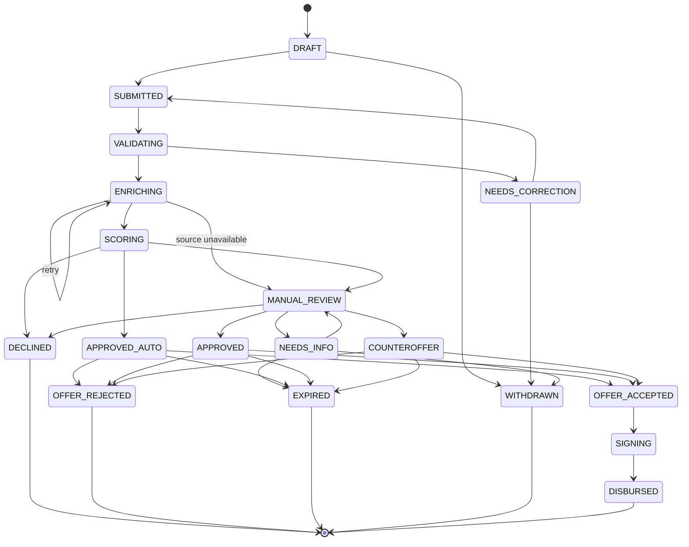

# Умный кредитный кабинет предпринимателя: исследование и модель процесса (MVP)

Хакатон «Альфа Будущее», кейс Альфа-Банка. Версия от 23.10.2026. Исходный документ — [`research.docx`](research.docx).

> Документ подготовлен до разработки и описывает исследование, границы MVP и модель процесса. Как это реализовано
> в коде: архитектура, диаграмма состояний и модель данных — [`architecture.md`](architecture.md), калибровка
> скоринговой карты — [`calibration.md`](calibration.md), где и зачем используется LLM — [`llm.md`](llm.md).

## 0. Как читать документ

Чтобы не смешивать факты и проектные решения, каждое утверждение помечено:

- **\[Факт\]**: взято из кейса или найдено в источнике (ссылки в разделе 12).
- **\[Вторичный источник\]**: найдено у агрегатора или в пересказе. Перед использованием в питче нужно проверить на первоисточнике.
- **\[Гипотеза\]**: предположение, которое нужно проверить интервью (CustDev). Это не результат исследования.
- **\[Решение MVP\]**: наше проектное решение. Это не факт о рынке. Все числа в таких пунктах являются настраиваемыми параметрами на синтетических данных и не откалиброваны на реальном портфеле.

Важно: интервью с реальными предпринимателями в рамках этой подготовки не проводились. Раздел 2 содержит гипотезы и гайд интервью, а не результаты опроса.

## 1. Проверенные факты

### 1.1. Из текста кейса

- **\[Факт\]** На 10.07.2026 в Едином реестре МСП 6,6 млн компаний и ИП, на 3,5% больше, чем годом ранее.
- **\[Факт\]** Целевые пользователи: собственник, генеральный директор, финансовый директор или бухгалтер, сотрудник, отвечающий за финансирование, сотрудник, работающий с банковскими продуктами, иной уполномоченный сотрудник. Пользователь может не обладать банковской экспертизой.
- **\[Факт\]** Ограничения кейса: синтетические данные, моки внешних сервисов, весь сценарий внутри продукта (без почты, SMS, звонков), веб-интерфейс, LLM только с открытыми весами, без платных API, Docker, OpenAPI, диаграмма состояний, модель данных, тестовые сценарии, THIRD_PARTY_NOTICES.
- **\[Факт\]** Кейс прямо различает скоринг и кредитное решение. Итог может быть не бинарным: одобрение, одобрение на иных условиях, другой продукт, запрос дополнительной информации, отказ.
- **Противоречие в цифрах кейса, нужно уточнить у организаторов.** В кейсе: «по состоянию на июль 2026 года банки выдали МСП 1,313 трлн рублей». По бюллетеню Банка России, за январь–апрель 2026 выдано 4,2 трлн руб., на 6,4% меньше, чем годом ранее. Значит, 1,313 трлн скорее относится к одному месяцу, а не к периоду «с начала года». Без уточнения периода эту цифру в презентации лучше не использовать. Также неясно, что значит «совокупный объем выдач превысил 1 трлн» у Альфа-Банка в октябре 2025 (за месяц или накопленным итогом).

### 1.2. Рынок МСП-кредитования

- **\[Факт\]** Банк России: за январь–апрель 2026 субъектам МСП выдано 4,2 трлн руб., на 6,4% меньше, чем годом ранее.
- **\[Факт\]** НКР (обзор МСП, июль 2026): на 1 мая 2026 каждый шестой субъект МСП с кредитом находился в просрочке. Доля просроченной задолженности 4,2%, к концу года может достичь 5%. Прирост портфеля МСП по итогам 2026 ожидается лишь 4–5%, льготные программы растут быстрее рыночных.
- **\[Вторичный источник\]** «Эксперт»: средневзвешенная ставка по «длинным» кредитам МСП в марте 2026 составила 16,5% против 20,6% годом ранее.
- **\[Вторичный источник\]** Господдержка: с июля 2026 заявлена программа кредитов на текущие расходы по ставке, равной ключевой, лимит 150 млрд руб. (операторы: банки и Корпорация МСП). Механизм «зонтичных» поручительств покрывает до 50% суммы кредита. Проверить на сайтах МСП.РФ и Минэкономразвития.

**Что это значит для продукта.** Банки сейчас осторожнее относятся к качеству МСП-портфеля, а часть клиентов идёт в льготные программы. Поэтому продукту нужны: (а) прозрачные причины и условия, (б) возможность предлагать иные условия вместо отказа, (в) учёт признака господдержки как свойства продукта.

### 1.3. Боли клиентов, подтверждённые источниками

- **\[Вторичный источник, 2023\]** Глава Корпорации МСП (Ведомости, 27.06.2023): 50% и более заявок МСП отклоняются, в отдельных отраслях до 70%. Названы причины: срок ведения бизнеса (охотнее одобряют компании старше полугода), финансовое состояние, долговая нагрузка, налоговая задолженность. Данные старые, использовать как контекст.
- **\[Вторичный источник, дата не подтверждена\]** Опрос «Опоры России» (индекс RSBI): число отказов выросло с 47 до 65%. Дату и методику проверить перед использованием.
- **\[Вторичный источник\]** Банки не раскрывают исчерпывающий перечень причин отказа (иначе, по словам представителя Корпорации МСП, это помогало бы мошенникам). Для клиента отказ часто выглядит как «чёрный ящик».
- **\[Вторичный источник\]** Предпринимателям советуют до подачи проверить налоговую задолженность и просрочки, не подавать недостоверные документы: их проверит служба безопасности.

**Вывод \[Решение MVP\].** Ценность кабинета для клиента: (1) предварительная самопроверка по самым частым причинам отказа до подачи, (2) объяснимый результат в категориях причин без раскрытия внутренних порогов, (3) всегда следующий шаг (доп. данные, другая сумма, другой срок, другой продукт).

### 1.4. Продуктовая линейка Альфа-Банка (ориентир для каталога)

Данные взяты с сайта банка (в части сниппетов) и агрегаторов. Цифры у разных источников расходятся, поэтому **в каталог MVP точные ставки не копируем**: используем типы продуктов и порядок параметров, а каталог помечаем как синтетический.

- **\[Факт, сайт банка\]** Для ООО: кредит одной суммой без залога и с залогом; кредитные линии (возобновляемая и невозобновляемая) с залогом, до 60 млн руб., срок 60 мес. Нужен хотя бы один поручитель, физлицо, являющееся собственником бизнеса. В кредите с залогом необеспеченная часть до 50% суммы. Ставка «от 14%» при подключении Защиты бизнеса и Подписки.
- **\[Вторичный источник\]** Овердрафт (ориентир: до 20 млн руб., 12 мес.), кредит на развитие без залога (ориентир: до 30 млн руб.), кредит с обеспечением (ориентир: до 150 млн руб., срок до 10 лет). Минимальный срок ведения бизнеса 9 мес. (у одного продукта 6 мес.). Заявлено «решение до 2 дней», у «быстрого» кредита «экспресс-решение за 5 минут».

### 1.5. Регуляторика, которая влияет на модель

- **\[Факт\]** 218-ФЗ «О кредитных историях», ст. 6: кредитный отчёт нельзя запросить без согласия субъекта. По разъяснению Банка России, согласие действует 6 месяцев со дня оформления, а если в этот срок заключён кредитный договор, лизинг, залог или поручительство, согласие сохраняет силу весь срок. Согласие должно содержать цель запроса и конкретное БКИ.
- **\[Факт\]** Положение Банка России № 590-П: резерв и категория качества ссуды определяются по финансовому положению заёмщика и качеству обслуживания долга. В информационных письмах ЦБ как контрольный показатель упоминается «Долг / (EBIT + амортизация)».
- **\[Вторичный источник\]** ЕГРЮЛ: адрес, учредители, виды деятельности, статус ликвидации или реорганизации. Сервис ФНС «Прозрачный бизнес»: среднесписочная численность, уплаченные налоги, недоимка, доходы и расходы, сведения об ИП из ЕГРИП и реестра МСП.

**Что это значит для модели \[Решение MVP\].** Отдельный шаг «Согласие на запрос БКИ» с датой, сроком действия и привязкой к версии заявки. Запрос к моку БКИ технически невозможен без активного согласия. Входы скоринга включают показатель долговой нагрузки по аналогии с «Долг/EBITDA». Банк работает не только с оценкой, но и с решением по продукту.

## 2. Пользователи: гипотезы и план CustDev

Всё в этом разделе \[Гипотеза\], пока не проверено интервью.

### 2.1. Работы, которые пользователь нанимает кабинет (JTBD)

| **№** | **Ситуация**                                         | **Хочу**                                                               | **Чтобы**                                      |
|-------|------------------------------------------------------|------------------------------------------------------------------------|------------------------------------------------|
| J1    | Возник кассовый разрыв или нужно купить оборудование | Понять, какой продукт мне подходит и сколько реально дадут             | Не тратить время на заявку, которую не одобрят |
| J2    | Я не финансист                                       | Заполнить заявку без банковских терминов, не вводя одно и то же дважды | Не ошибиться и не бросить на полпути           |
| J3    | Заявка подана                                        | Видеть статус и следующий шаг                                          | Планировать платежи и не звонить в банк        |
| J4    | Пришёл отказ или другие условия                      | Понять, что можно изменить                                             | Подать снова или принять встречное предложение |
| J5    | Заявку готовит бухгалтер, решает директор            | Передать заявку и согласовать условия внутри компании                  | Не терять контекст между людьми                |

По стороне банка:

| **№** | **Роль**                         | **Хочу**                                                                              | **Чтобы**                                         |
|-------|----------------------------------|---------------------------------------------------------------------------------------|---------------------------------------------------|
| B1    | Кредитный аналитик               | Видеть заявку, результаты проверок и скоринг на одном экране, с разбивкой по факторам | Быстро принимать решение по нестандартным случаям |
| B2    | Руководитель кредитного процесса | Видеть очередь, этапы, время на этапах, причины отказов                               | Управлять процессом и находить узкие места        |

### 2.2. Гайд интервью (30 минут, 5–8 респондентов)

Рекрутинг: собственники ИП и малых ООО, главбухи и финансисты малого бизнеса, у кого был опыт кредита или отказа за последние 2 года. Минимум по одному респонденту на каждый тип роли из кейса.

1.  Расскажите про последний раз, когда вам понадобилось внешнее финансирование. С чего всё началось?
2.  Как вы выбирали продукт и банк? Что искали, где?
3.  Какие документы и данные пришлось собирать? Что вводили повторно?
4.  Сколько времени прошло от решения подать заявку до ответа? Где ждали дольше всего?
5.  Что было непонятно по ходу процесса?
6.  Если был отказ или другие условия: как вы об этом узнали? Что сделали дальше?
7.  Кто в компании принимал решение, кто заполнял заявку?
8.  Что вас точно отпугнуло бы в кабинете?

Фиксировать: цитаты, число шагов и повторных вводов, сроки, кто участвует. Результат: карта пути (user journey) и приоритизация MoSCoW или ICE по каждой боли.

## 3. Границы процесса и состав MVP

### 3.1. Участники

| **Роль**                        | **Что делает в MVP**                                                                                                    |
|---------------------------------|-------------------------------------------------------------------------------------------------------------------------|
| Клиент (представитель компании) | Подбирает продукт, заполняет заявку, даёт согласия, отвечает на запрос доп. данных, принимает или отклоняет предложение |
| Кредитный аналитик              | Разбирает заявки серой зоны, запрашивает доп. данные, принимает решение, формирует встречное предложение                |
| Система                         | Валидация, обогащение из моков, скоринг, применение кредитных правил, смена статусов, журнал                            |
| Администратор (минимально)      | Настройка каталога продуктов и параметров скоринга                                                                      |

### 3.2. Что входит и что нет (MoSCoW) \[Решение MVP\]

| **Приоритет** | **Функция**                                                                                                  | **Почему**                                       |
|---------------|--------------------------------------------------------------------------------------------------------------|--------------------------------------------------|
| Must          | Подбор продукта по цели, сумме, сроку                                                                        | Критерий кейса: клиент может выбрать продукт     |
| Must          | Профиль компании с автозаполнением по ИНН из мока ЕГРЮЛ                                                      | Сокращает повторный ввод (цель кейса)            |
| Must          | Заявка, согласия, отправка, неизменяемый снимок данных                                                       | Сквозной путь и аудит                            |
| Must          | Приём и проверка полноты и корректности                                                                      | Прямо описано в кейсе (стр. 13)                  |
| Must          | Обогащение: мок ФНС и «Прозрачный бизнес», мок БКИ                                                           | Прямо описано в кейсе                            |
| Must          | Скоринг и кредитное решение (одобрить, на иных условиях, доп. информация, отказ)                             | Критерий кейса, итог не бинарен                  |
| Must          | Кабинет аналитика с очередью и ручным решением                                                               | Обработка со стороны банка                       |
| Must          | Статусы заявки в реальном времени, история изменений                                                         | Прозрачность для клиента                         |
| Must          | Принятие предложения, мок подписания, мок выдачи                                                             | Допускается моделировать (стр. 11)               |
| Should        | Предварительная самопроверка до подачи                                                                       | Отвечает на главную боль «отказ как чёрный ящик» |
| Should        | Приглашение коллеги и роли внутри компании                                                                   | Закрывает J5                                     |
| Should        | Загрузка документов (без распознавания)                                                                      | Запрос доп. данных                               |
| Could         | Объяснение решения простым языком через LLM с открытыми весами, детерминированный текст как запасной вариант | ИИ только там, где даёт ценность                 |
| Could         | Распознавание документов (открытый OCR)                                                                      | Дополнительная ценность, не основной сценарий    |
| Won’t         | Реальные интеграции, реальное подписание и выдача, мобильное приложение, платные API                         | Запрещено или не нужно для проверки              |

## 4. Модель сквозного процесса

| **Этап**              | **Кто**         | **Вход**                                            | **Действие**                                                             | **Выход**                                                         |
|-----------------------|-----------------|-----------------------------------------------------|--------------------------------------------------------------------------|-------------------------------------------------------------------|
| 1\. Подбор            | Клиент          | Цель, сумма, срок, наличие залога и поручителя      | Мастер подбирает 1–3 продукта и объясняет, почему они подходят           | Выбранный продукт                                                 |
| 2\. Профиль           | Клиент, система | ИНН                                                 | Автозаполнение из мока ЕГРЮЛ/ЕГРИП, клиент подтверждает                  | Данные компании, проверка полномочий                              |
| 3\. Заявка            | Клиент          | Параметры, финпоказатели, действующие обязательства | Заполнение, черновик сохраняется автоматически                           | Черновик                                                          |
| 4\. Согласия          | Клиент          | Тексты согласий                                     | Согласие на обработку ПД и на запрос БКИ (с датой и сроком действия)     | Записи согласий                                                   |
| 5\. Отправка          | Клиент          | Полная заявка                                       | Фиксация снимка данных, присвоение номера                                | Статус «Отправлена»                                               |
| 6\. Приём и проверка  | Система         | Снимок заявки                                       | Полнота, формат, соответствие лимитам продукта, минимальный срок бизнеса | Прошла или запрос исправлений                                     |
| 7\. Обогащение        | Система         | ИНН, согласие                                       | Вызов моков ФНС и БКИ, сохранение ответов с источником и временем        | Профиль проверок                                                  |
| 8\. Скоринг и решение | Система         | Данные заявки и проверки                            | Балльная оценка, затем кредитные правила продукта                        | Авто-одобрение, авто-отказ, ручной разбор, запрос доп. информации |
| 9\. Ручной разбор     | Аналитик        | Карточка заявки с факторами                         | Решение, комментарий, изменение условий                                  | Одобрено, на иных условиях, нужна информация, отказ               |
| 10\. Результат        | Клиент          | Решение                                             | Предложение или причина в понятных категориях, или запрос данных         | Принять, отклонить, дополнить                                     |
| 11\. Оформление       | Клиент, система | Принятое предложение                                | Мок подписания, мок выдачи                                               | «Выдан»                                                           |

## 5. Диаграмма состояний заявки

### 5.1. Статусы и переходы \[Решение MVP\]

| **Из**                                | **В**                              | **Событие**             | **Кто**         | **Условие**                                                          |
|---------------------------------------|------------------------------------|-------------------------|-----------------|----------------------------------------------------------------------|
| DRAFT                                 | SUBMITTED                          | Отправка                | Клиент          | Все обязательные поля и согласия                                     |
| SUBMITTED                             | VALIDATING                         | Автозапуск              | Система         |                                                                      |
| VALIDATING                            | NEEDS_CORRECTION                   | Ошибки данных           | Система         | Найдены ошибки полноты и корректности                                |
| NEEDS_CORRECTION                      | SUBMITTED                          | Повторная отправка      | Клиент          |                                                                      |
| VALIDATING                            | ENRICHING                          | Валидация пройдена      | Система         |                                                                      |
| ENRICHING                             | SCORING                            | Проверки получены       | Система         | Мок доступен, согласие БКИ активно                                   |
| ENRICHING                             | ENRICHING                          | Повтор                  | Система         | Ошибка мока, ограниченное число попыток                              |
| ENRICHING                             | MANUAL_REVIEW                      | Недоступность источника | Система         | Исчерпаны попытки, передача аналитику                                |
| SCORING                               | APPROVED_AUTO                      | Решение                 | Система         | Нет жёстких стопов, оценка выше верхнего порога, сумма в авто-лимите |
| SCORING                               | DECLINED                           | Решение                 | Система         | Жёсткий стоп или оценка ниже нижнего порога                          |
| SCORING                               | MANUAL_REVIEW                      | Серая зона              | Система         | Оценка между порогами или сумма выше авто-лимита                     |
| MANUAL_REVIEW                         | NEEDS_INFO                         | Запрос данных           | Аналитик        |                                                                      |
| NEEDS_INFO                            | MANUAL_REVIEW                      | Ответ клиента           | Клиент          | В срок                                                               |
| NEEDS_INFO                            | EXPIRED                            | Срок истёк              | Система         |                                                                      |
| MANUAL_REVIEW                         | APPROVED / COUNTEROFFER / DECLINED | Решение                 | Аналитик        | Комментарий обязателен                                               |
| APPROVED_AUTO, APPROVED, COUNTEROFFER | OFFER_ACCEPTED                     | Принятие                | Клиент          | Предложение не истекло                                               |
| APPROVED_AUTO, APPROVED, COUNTEROFFER | OFFER_REJECTED, EXPIRED            | Отказ или срок          | Клиент, система |                                                                      |
| OFFER_ACCEPTED                        | SIGNING                            | Автозапуск              | Система         |                                                                      |
| SIGNING                               | DISBURSED                          | Мок подписания и выдачи | Система         |                                                                      |
| DRAFT, NEEDS_CORRECTION, NEEDS_INFO   | WITHDRAWN                          | Отзыв                   | Клиент          |                                                                      |

Конечные статусы: DECLINED, OFFER_REJECTED, EXPIRED, WITHDRAWN, DISBURSED. Любой переход пишется в журнал (кто, когда, из какого статуса, основание). Недопустимый переход отклоняется на уровне сервиса, а не интерфейса.

### 5.2. Код диаграммы (Mermaid, для README и GitHub)

## 6. Скоринг и кредитное решение

Целенаправленно разделены три слоя, как в кейсе: проверки, скоринг, кредитная логика.

### 6.1. Слой 1. Жёсткие стопы (knock-out) \[Решение MVP\]

Этот слой отражает самые частые названные причины отказов (раздел 1.3) и требования продуктов (раздел 1.4).

| **Стоп**                                          | **Источник**       | **Результат**                                     |
|---------------------------------------------------|--------------------|---------------------------------------------------|
| Компания в процессе ликвидации или реорганизации  | Мок ЕГРЮЛ          | Отказ                                             |
| Срок ведения бизнеса меньше минимума продукта     | Мок ЕГРЮЛ, каталог | Отказ по этому продукту, предложить другой        |
| Действующая просрочка по БКИ выше порога          | Мок БКИ            | Отказ                                             |
| Отсутствует действующее согласие на БКИ           | Модель согласий    | Запрос невозможен, возврат на этап согласий       |
| Запрашиваемая сумма или срок вне лимитов продукта | Каталог            | Ошибка валидации с подсказкой допустимых значений |

### 6.2. Слой 2. Скоринговая карта v0 (балльная, объяснимая) \[Решение MVP\]

Балльная модель выбрана потому, что кейс допускает правила и баллы, а аналитик должен видеть вклад каждого фактора. Баллы являются параметрами конфигурации, не результатом калибровки.

| **Фактор**                                                | **Источник**              | **Эффект**                                                        |
|-----------------------------------------------------------|---------------------------|-------------------------------------------------------------------|
| Срок бизнеса                                              | ЕГРЮЛ                     | Чем дольше, тем выше балл                                         |
| Долговая нагрузка: (Долг + запрос) / (EBIT + амортизация) | Анкета, БКИ               | Основной штрафной фактор по аналогии с контрольным показателем ЦБ |
| Налоговая недоимка                                        | Мок «Прозрачного бизнеса» | Штраф, при значимой сумме передача на ручной разбор               |
| Динамика выручки                                          | Анкета                    | Рост добавляет, падение снижает                                   |
| Платёжная дисциплина (число и срок просрочек за период)   | Мок БКИ                   | Штраф, масштабируется по давности и размеру                       |
| Отношение запроса к годовой выручке                       | Анкета                    | Штраф при высоком значении                                        |
| Наличие обеспечения или поручительства собственника       | Анкета, каталог           | Добавляет баллы                                                   |

Диапазон оценки 0–100. Три зоны: высокая (авто-одобрение при сумме ниже авто-лимита), серая (ручной разбор), низкая (отказ). Пороги и веса хранятся в конфигурации с версией модели, версия сохраняется вместе с результатом скоринга.

### 6.3. Слой 3. Кредитная логика продукта \[Решение MVP\]

Одинаковая оценка может дать разные условия для разных продуктов. Логика получает на вход оценку, продукт, сумму, срок и стопы и возвращает один из исходов: одобрено, одобрено на иных условиях (меньше сумма, другой срок, требуется поручитель или залог), нужна информация, отказ. Ставка = базовая ставка продукта + надбавка по грейду оценки (параметры синтетические).

### 6.4. Объяснимость

Аналитику показываются вклады факторов. Клиенту показываются категории причин («срок работы бизнеса», «долговая нагрузка», «налоговая задолженность», «платёжная история») и действия («что можно изменить»), без внутренних порогов. Это решает боль «отказ как чёрный ящик» и не раскрывает правила, которые банки обычно не публикуют.

## 7. Модель данных (основные сущности)

| **Сущность**           | **Ключевые поля**                                                                                                                                  |
|------------------------|----------------------------------------------------------------------------------------------------------------------------------------------------|
| User                   | id, email (логин в демо), роль (CLIENT, ANALYST, ADMIN)                                                                                            |
| Company                | id, ИНН, ОГРН, тип (ИП, ООО), название, дата регистрации, ОКВЭД, статус                                                                            |
| CompanyMember          | user_id, company_id, должность, право оформлять заявки                                                                                             |
| Product                | id, код, тип, мин. и макс. сумма, мин. и макс. срок, мин. срок бизнеса, требует залог или поручителя, базовая ставка, признак господдержки, версия |
| Application            | id, номер, company_id, product_id, сумма, срок, цель, статус, версия записи (оптимистичная блокировка)                                             |
| ApplicationSnapshot    | application_id, номер версии, JSON данных на момент отправки, хеш                                                                                  |
| FinancialIndicators    | application_id, период, выручка, расходы, EBIT, амортизация, действующий долг, ежемесячные платежи                                                 |
| Consent                | id, тип (ПД, БКИ), subject, цель, БКИ, дата, срок действия, хеш текста                                                                             |
| Document               | id, application_id, тип, имя, размер, хеш, загружен кем                                                                                            |
| ExternalCheck          | id, application_id, источник (FNS_MOCK, BKI_MOCK), запрос, ответ, время, признак «смоделировано»                                                   |
| ScoringResult          | id, application_id, версия модели, оценка, вклады факторов, зона                                                                                   |
| Decision               | id, application_id, тип, условия, коды причин, принял (SYSTEM или user), комментарий                                                               |
| Offer                  | id, decision_id, сумма, срок, ставка, действует до, статус                                                                                         |
| StatusHistory          | id, application_id, из, в, событие, актор, время, причина                                                                                          |
| ReviewTask             | id, application_id, назначен, приоритет, срок                                                                                                      |
| Contract, Disbursement | Мок: номер, дата, статус                                                                                                                           |

Принципы: внешние ответы и скоринг хранятся как есть (воспроизводимость и аудит), статус меняется только через сервис переходов, повторная отправка команды не создаёт дубль (ключ идемпотентности).

## 8. Архитектурные принципы под критерии «enterprise»

Всё в этом разделе \[Решение MVP\], конкретный стек выбирает команда.

- Модульный монолит с чёткими границами модулей (клиентский контур, процесс заявки, скоринг, интеграции) и отдельным воркером для асинхронного конвейера. Микросервисы на хакатоне увеличат риск без ценности для проверки, но границы модулей позволяют разделить их позже. Это нужно проговорить в «потенциале развития».
- Моки ФНС и БКИ как отдельные контейнеры со своим контрактом (упрощённым), чтобы интеграции можно было заменить.
- PostgreSQL, миграции, транзакционный outbox или очередь для событий смены статуса. Обновление статуса клиенту через опрос или SSE.
- Docker Compose: один запуск всего стека, healthcheck, lock-файлы зависимостей, версии образов зафиксированы.
- Безопасность: хеширование паролей, RBAC на уровне API (клиент видит только свои компании), журнал аудита, секреты через переменные окружения, шифрование чувствительных полей, минимизация данных в логах.
- Надёжность: идемпотентность, повтор запросов к моку с ограничением попыток, деградация в ручной разбор при недоступности источника.
- OpenAPI/Swagger, коллекция запросов (Postman или Bruno), диаграмма состояний, архитектурная схема, модель данных, THIRD_PARTY_NOTICES с пометкой «смоделировано» для ФНС и БКИ.
- ИИ: только open-weight модель, только в пункте «объяснение решения простым языком» или в помощнике подбора продукта, с детерминированным запасным текстом, чтобы основной сценарий не зависел от модели.

## 9. Тестовые сценарии для сквозной проверки (E2E)

Для демо нужен набор синтетических компаний с заведомо вымышленными данными и явной пометкой в README.

| **№** | **Сценарий**                                            | **Ожидаемый путь статусов**                                                |
|-------|---------------------------------------------------------|----------------------------------------------------------------------------|
| T1    | Стабильная компания, небольшая сумма                    | DRAFT → … → SCORING → APPROVED_AUTO → OFFER_ACCEPTED → SIGNING → DISBURSED |
| T2    | Компания младше минимального срока продукта             | … → DECLINED, клиент видит причину и альтернативный продукт                |
| T3    | Действующая просрочка в моке БКИ                        | … → DECLINED                                                               |
| T4    | Серая зона, крупная сумма                               | … → MANUAL_REVIEW → COUNTEROFFER → OFFER_ACCEPTED → DISBURSED              |
| T5    | Аналитик запрашивает данные                             | MANUAL_REVIEW → NEEDS_INFO → (ответ) → MANUAL_REVIEW → APPROVED            |
| T6    | Клиент отклоняет предложение или предложение истекает   | … → OFFER_REJECTED или EXPIRED                                             |
| T7    | Нет согласия на БКИ                                     | Отправка заблокирована, запрос в мок не уходит                             |
| T8    | Мок ФНС недоступен                                      | ENRICHING (повторы) → MANUAL_REVIEW с пометкой                             |
| T9    | Двойная отправка, одновременное решение двух аналитиков | Один результат, второй получает конфликт версии                            |
| T10   | Чужая заявка по прямой ссылке                           | Отказ доступа (проверка RBAC)                                              |

## 10. Соответствие критериям кейса

| **Критерий**            | **Чем закрываем**                                                      |
|-------------------------|------------------------------------------------------------------------|
| Целостность             | Один путь от подбора до «Выдан»                                        |
| Готовность к проверке   | Docker Compose, демо-пользователи, сценарии T1–T10                     |
| Качество опыта          | Мастер подбора, самопроверка, статусы, объяснимые причины              |
| Согласованность модулей | Одна машина состояний, журнал, снимки данных                           |
| Enterprise              | Раздел 8                                                               |
| Потенциал развития      | Замена моков, калибровка скоринга, переход на сервисы, документооборот |

## 11. Открытые вопросы и что проверить

1.  Уточнить у организаторов период в цифрах 1,313 трлн и «1 трлн» Альфа-Банка (раздел 1.1).
2.  Проверить условия господдержки на первоисточниках (МСП.РФ, Минэкономразвития).
3.  Проверить условия продуктов Альфа-Банка на самом сайте (агрегаторы расходятся).
4.  Уточнить дату и методику опроса «Опоры России» (RSBI).
5.  В кейсе не указан дедлайн сдачи. Для плана нужно уточнить.
6.  Бенчмарк конкурентов (кредитные кабинеты других банков для МСП) в этой подготовке не проводился. Рекомендуется сделать до интервью.
7.  Провести CustDev (раздел 2.2) и обновить статусы «Гипотеза» на «Факт».

## 12. Источники

- Кейс «Умный кредитный кабинет предпринимателя», Changellenge \>\> и Альфа-Банк (загруженный PDF).
- Банк России, Кредитование субъектов МСП за апрель 2026: https://www.cbr.ru/Collection/Collection/File/62075/stat_bulletin_lending_26-04_71.pdf
- НКР, обзор МСП, июль 2026: https://ratings.ru/files/research/banks/NCR_SME_July2026.pdf
- Эксперт, «Выдача с тремя неизвестными»: https://expert.ru/finance/vydacha-s-tremya-neizvestnymi
- Господдержка, кредиты по ставке ключевой (вторичный источник): https://robokassa.com/blog/news/novaya-programma-kreditovaniya-dlya-msp-s-limitom-150-mlrd-rubley-startuet-v-iyule-2026-goda/
- Зонтичные поручительства (вторичный источник): https://investfuture.ru/articles/maliy-biznes-privlechet-900-mlrd-rubley-s-pomoschyu-gospodderzhki-v-2026-godu-D98AA0948F28538243258DA90042406F
- Ведомости, причины отказов (2023): https://www.vedomosti.ru/business/articles/2023/06/27/982408-v-korporatsii-msp-nazvali-osnovnie-prichini-otkazov
- Inc. Russia, пересказ Корпорации МСП: https://incrussia.ru/news/prichiny-otkazov-biznesu-v-kredite/
- Inc. Russia, индекс RSBI: https://incrussia.ru/news/issledovanie-stagnatsiya-malogo-i-srednego-biznesa-smenilas-padeniem/
- Альфа-Банк, кредит для ООО: https://alfabank.ru/sme/profits/kredit-dlya-ooo/
- Сравни.ру, кредиты для ИП в Альфа-Банке: https://www.sravni.ru/biznes-kredity/dlya-ip/bank/alfa-bank/
- Банкирос, продукты Альфа-Банка: https://bankiros.ru/bank/alfabank/business-credits/dengi-na-delo
- Банк России, кредитные истории и согласие: https://cbr.ru/ckki/
- Банк России, подтверждение согласия БКИ: https://www.cbr.ru/Crosscut/LawActs/File/5821
- Банк России, информационное письмо по 590-П: https://www.cbr.ru/Crosscut/LawActs/File/10027
- ФНС, сведения о юрлицах (пересказ): https://ppt.ru/art/ooo/svedeniya-o-yuridicheskikh-litsakh-v-fns
- ФНС, «Прозрачный бизнес» (пересказ): https://pravo.ppt.ru/informatsiya/232072
